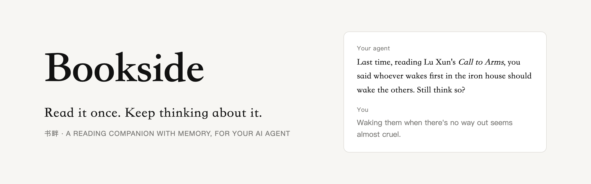

<p align="center">
  <picture>
    <source media="(prefers-color-scheme: dark)" srcset="docs/images/banner-en-dark.png">
    
  </picture>
</p>

<p align="center"><a href="README.md">简体中文</a> · <b>English</b></p>

<p align="center">
  <a href="https://www.npmjs.com/package/bookside"></a>
  <a href="LICENSE"></a>
  <a href="https://nodejs.org"></a>
  <a href="https://agentskills.io"></a>
</p>

<p align="center">
  <a href="#get-started-in-five-minutes">Get started</a> ·
  <a href="#everyday-use">Everyday use</a> ·
  <a href="#faq">FAQ</a> ·
  <a href="https://github.com/codemaster1024/bookside/issues">Feedback</a>
</p>

---

**Bookside** lets the AI agent you already use — Claude Code, Codex, or any agent that loads [Agent Skills](https://agentskills.io) — keep you company while you read. It brings in your highlights from WeChat Read (微信读书) or Kindle and asks what you make of them. The questions you want to keep thinking about, it remembers, and the next time you sit down to talk about books it asks again: *how do you see it now?*

Everything stays on your own computer. Over time, scattered highlights grow into a reading memory that is yours alone.

> **Note:** the interface, prompts and sample book are in Chinese. Bookside works with books in any language, but it is built first for Chinese readers.

## Why Bookside

- **You highlight hundreds of passages and rarely look back.** They sit in an app and sink once you finish the book.
- **AI can summarize a book in seconds — in its words, not yours.** The summary does the reading for you; what *you* think has nowhere to live.
- **However good the conversation, your agent forgets it.** Every session starts from zero, and the question you were halfway through last month is gone.

Bookside makes your agent **remember what you are thinking about**, and pick it up again the next time you read.

## Highlights

- **Understand first, then think it through.** A one-minute overview helps you decide whether to read a book and where to start; full and chapter guides lay out the structure and key ideas — for Kindle books too.
- **Questions, not just summaries.** New highlights get a question: do you agree? what does it remind you of? It asks about you, not about the book.
- **Remembers what you want to keep thinking about.** Keep a question and it becomes a long-running thread. Your words and the AI's are stored apart; every view you settle on is marked as written by you or AI-assisted.
- **Brings things up at the right moment — and never nags.** No notifications, nothing running in the background. When you come to talk about books, it raises just one thing worth talking about.
- **Highlights that don't sink.** When you feel like it, it brings back a few highlights from a month or more ago and asks how they read now; it can also recap what you cared about in a book, or quiz you on it.
- **Connects your books.** When a passage in a new book may answer a question you asked about another, it points it out and waits for you to confirm.
- **Reads each book the way it wants to be read.** Arguments get challenged, how-to books get "did you try it?", science gets "explain it back", novels get talked about — without spoilers past where you are.
- **Your data stays yours.** One local file, exportable any time as Markdown that Obsidian opens directly. Bookside itself calls no AI model — your agent does the thinking — so there is no model API key to get, and nothing is collected.

## What it feels like

> **You:** 用书畔陪我读书 *(Read with me, Bookside)*
>
> **Agent:** Last time, reading Lu Xun's *Call to Arms*, you said whoever wakes first in the iron house should wake the others, "even if there's little hope". Still think so?
>
> **You:** Hmm… waking them when there's no way out seems almost cruel.
>
> **Agent:** Lu Xun hesitated in exactly the same way in his preface. Who should decide whether there's a way out — the one who woke first, or the ones being woken?
>
> **You:** …that's worth keeping.

The conversation goes into the thread of the "iron house" question. Come back in a while and it picks up from here; read a passage elsewhere that speaks to it, and it will point that out too.

## Compared with the usual approaches

| | Note-export tools | Asking AI to summarize | Bookside |
| --- | :---: | :---: | :---: |
| All your highlights in one place | ✓ | | ✓ |
| The gist of a book in a minute | | ✓ | ✓ |
| Asks what you think instead of reading for you | | | ✓ |
| Remembers your questions across weeks and months | | | ✓ |
| Finds passages in new books that answer old questions | | | ✓ |
| Adapts to the kind of book, no spoilers in novels | | | ✓ |
| What remains is in your own words | ✓ | | ✓ |

## Get started in five minutes

You need [Node.js](https://nodejs.org) 24 or later and an agent that loads skills, such as Claude Code, Codex, Cursor or Trae.

**1. Install**

```sh
npm install -g bookside
```

**2. Try the sample book first** (no account or key needed)

```sh
bookside init --sample
```

This adds a sample book — Lu Xun's *Call to Arms* (《呐喊》), read up to the story *My Old Home*, with a few highlights, a pending question and one ready to revisit — and installs Bookside into the agents on your machine.

**3. Open your agent and say**

> 用书畔陪我读书

It should ask you about the "iron house". Keep going, or try something else: "I haven't read *The True Story of Ah Q* yet — no spoilers, what is this book about?" If nothing happens, run `bookside doctor`; it tells you what is missing and how to fix it.

**4. Have a look in the browser**

```sh
bookside web
```

Open `http://localhost:4317/` — what you just talked about is there.

**5. Switch to your own books**

```sh
bookside init             # choose WeChat Read or Kindle
bookside sample --remove  # remove the sample book
```

## Bring in your books

- **WeChat Read**: get a key at [weread.qq.com/r/weread-skills](https://weread.qq.com/r/weread-skills) and enter it when `bookside init` asks. From then on, tell your agent to sync. The key only reads your own shelf and highlights, and is stored locally, readable by you alone.
- **Kindle**: connect your Kindle, find `My Clippings.txt` in its `documents` folder, and give the path to `bookside init`. Importing the same file again only adds what's new.

Everything in your first import counts as already read, so you won't get hundreds of questions at once — only new highlights get asked about.

## Everyday use

No commands to remember — just talk to your agent (in Chinese or English):

| To | Say something like |
| --- | --- |
| Start a reading session | "用书畔陪我读书" (read with me, Bookside) |
| Start a new book | "I'm starting *Thinking, Fast and Slow*" |
| Understand a passage | "What does 'doublethink' really mean in *1984*?" |
| Talk about a highlight | "I highlighted 'intuition is nothing more and nothing less than recognition' — what do you think?" |
| Keep thinking about it | "That's worth keeping" |
| See what's waiting | "Any questions waiting for me?" |
| Get the gist fast | "Give me a one-minute take on *Sapiens*" |
| Get a guide | "Walk me through *Atomic Habits*" / "What is this chapter about?" |
| Recap your highlights | "What did I highlight in this book?" |
| Revisit old highlights | "Show me a few old highlights" |
| Test yourself | "Quiz me" |
| Search old highlights | "Did I highlight anything about this before?" |
| Wrap up a book | "Help me turn this book into my own takeaways" |
| Change the reading mode | "Read *Sapiens* as a story" |
| Change the questioning style | "Argue against me like a debater" |
| Sync | "Sync WeChat Read" / "Import my new Kindle highlights" |

## Reading modes

Each book gets a **reading mode**, guessed from its WeChat Read category; you can change it any time:

| Mode | For | It asks | Later it asks | What you keep |
| --- | --- | --- | --- | --- |
| Argument | Philosophy, social science, history | Does the argument hold? What would the other side say? | How do you see it now? | Views |
| Practice | Self-improvement, management, finance | Where would you use this? What's the first step? | Did you try it? How did it go? | Practice notes |
| Knowledge | Science, technology, textbooks | Explain it in your own words | Can you still explain it? | Your understanding |
| Narrative | Novels, biographies | What moved you? Why did the character do that? | Reading it again, has the feeling changed? | Reflections |

For narrative books you haven't finished, guides and conversations stop where you are.

## How it brings up your questions

Bookside sends no notifications, runs nothing in the background, and never reaches out. A kept question becomes "due" after a while (3 days, a week, three weeks, two months), and due questions come up only **when you come to talk about books** — one at a time:

- Something new first: a passage in another book that may answer an old question.
- When you are talking about a book, that book's questions first.
- When you finish a book, its questions come out together for a wrap-up.

Not in the mood? Say "don't ask me about this for now" (it comes back in about two months) or "I don't want to think about this anymore" (it stops, the question stays).

## In the browser

`bookside web` opens a read-only page: the home page shows where to start next time, the questions you are thinking about, recent views and recent books; each book shows its guide, questions, views and highlights by chapter. Every item has a 「接着聊」 (*keep talking*) button that copies a sentence to paste into your agent.

| Home | Book |
| --- | --- |
|  |  |

Only your computer can open it by default. To read it on your phone on the same network, use `bookside web --host` (anyone on that network can see it — read-only).

## Privacy and data

- **Everything is on your computer**: `~/.bookside/bookside.db` (a single SQLite file) and `~/.bookside/config.json`. Set `BOOKSIDE_HOME` to move it.
- **Take it with you**: `bookside export` writes Markdown that Obsidian opens directly — one file per book and per question, linked together, with links that jump to the exact highlight.
- **Nothing is collected**: no telemetry, no account. Bookside calls no models and talks only to WeChat Read — to read your own shelf, highlights and notes, and, for guides, a book's table of contents, blurb and popular highlights; cover images in the viewer come from WeChat Read too. With Kindle or the sample book only, it never goes online.

## FAQ

**How is this different from letting my agent read my notes?**
Your agent starts every conversation from zero. Bookside remembers what spans weeks and months — the questions you asked, what you said in your own words, how your views changed, which new book answered which old question — and brings out the right one when you come back.

**Do I need a model API key? Does it cost extra?**
No. Bookside itself never calls an AI model; your agent does the thinking, at whatever it normally costs you. The only key is WeChat Read's, needed just to read your own shelf and highlights there; with Kindle or the sample book you need no key at all.

**Can it remind me on a schedule?**
No, on purpose. It only brings things up when you come to it.

**Will it work with my agent?**
Any agent that can run commands and load skills works. `bookside init` finds the agents installed on your computer and puts Bookside into the skill folder each one reads; installed one later, run `bookside init` again. If yours isn't picked up, use the general installer: `npx skills add codemaster1024/bookside -g`.

**I already have a skill called bookside?**
`init` never overwrites a same-named skill it didn't install; `bookside doctor` will tell you.

**How do I upgrade?**
`npm update -g bookside`. The skill in your agents switches to the new version the next time you talk about books.

**How do I uninstall?**
`npm uninstall -g bookside`, then delete `~/.bookside` and the `bookside` folder in each agent's skills directory.

## Get involved

- Found a problem or have an idea? [Open an issue](https://github.com/codemaster1024/bookside/issues).
- Find Bookside useful? Star the repo so more readers can find it.
- Want to hack on it:

```sh
git clone https://github.com/codemaster1024/bookside.git && cd bookside
pnpm install
pnpm test        # tests
pnpm typecheck   # type check
pnpm build       # build the npm package into packages/bookside
ln -s "$PWD/packages/cli/src/main.ts" ~/.local/bin/bookside   # run from source (any directory on your PATH)
```

## License

[MIT](LICENSE). Bookside reads your own data through WeChat Read's open Agent Skills API. It is not affiliated with Tencent, WeChat Read or Amazon Kindle.
