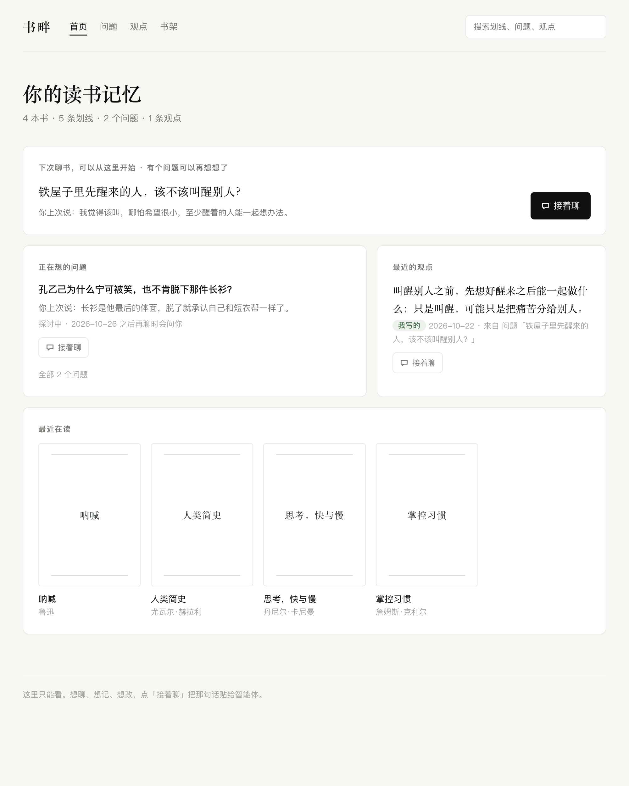
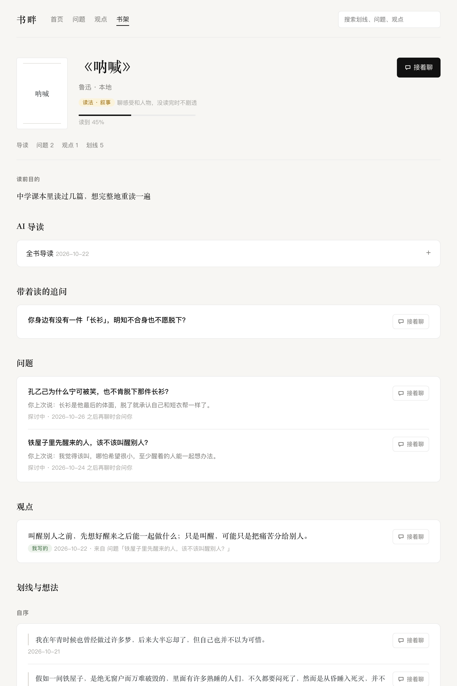

<p align="center">
  <picture>
    <source media="(prefers-color-scheme: dark)" srcset="docs/images/banner-zh-dark.png">
    
  </picture>
</p>

<p align="center"><b>简体中文</b> · <a href="README.en.md">English</a></p>

<p align="center">
  <a href="https://www.npmjs.com/package/bookside"></a>
  <a href="LICENSE"></a>
  <a href="https://nodejs.org"></a>
  <a href="https://agentskills.io"></a>
</p>

<p align="center">
  <a href="#五分钟上手">五分钟上手</a> ·
  <a href="#平时怎么用">平时怎么用</a> ·
  <a href="#常见问题">常见问题</a> ·
  <a href="https://github.com/codemaster1024/bookside/issues">提建议</a>
</p>

---

**书畔**让你正在用的 AI 智能体（Claude Code、Codex 等）陪你读书。它接过你在微信读书或 Kindle 里的划线，问你怎么看；你想继续想的，它记下来，等你下次来聊书时再问你——"现在怎么看？"

聊过的东西都留在你自己的电脑上。日子久了，零散的划线会长成一份只属于你的读书记忆。

## 为什么做书畔

- **划了几百条线，很少再回头看。** 划线散落在 App 里，读完就沉底了。
- **让 AI 总结一本书很快，但留下的是它的话。** 总结替你读完了，你自己怎么想，没有地方留下。
- **和 AI 聊得再好，下次打开它也不记得。** 每次对话都从零开始，上个月想通一半的问题，再也接不上了。

书畔做的，是让智能体**记住你在想什么**，并在你下次读书时接着问下去。

## 亮点

- **先读懂，再想下去。** 一分钟的速览帮你决定读不读、先读哪部分；全书导读和章节导读讲清结构与核心观点，Kindle 里的书也能写。
- **追问，而不是只给总结。** 新划线会被问一句：你同意吗？和你哪段经历有关？问的是你，不考书的内容。
- **记住你想继续想的。** 愿意想下去的，记成一个问题；你的原话和 AI 的话分开记，整理出的观点标明是你写的还是 AI 协助的。
- **在合适的时候提起，不打扰。** 不发通知、不在后台运行。你来聊书时，它只挑一件最值得聊的：一个到期的问题，或一段刚发现的联系。
- **让划线不沉底。** 想翻翻旧划线时，它挑几条你一个月前划的，问你现在读来怎么看；还能回顾你在一本书里都关心了什么，或者出几道题考考你。
- **把不同的书连起来。** 新书里有一段可能回答了你在另一本书里提过的问题，它会指给你看，等你确认。
- **按书的类型陪你读。** 思辨类追问论证，实践类问"试了吗"，知识类请你讲一遍，小说聊人物和感受，并且不剧透你还没读到的部分。
- **数据在你手里。** 一个本地文件，随时导出成 Obsidian 能直接打开的 Markdown。书畔本身不调用 AI 模型，思考由你正在用的智能体完成，所以不用另外申请模型的 Key；也不收集任何数据。

## 用起来是这样的

> **你**：用书畔陪我读书
>
> **智能体**：上次读《呐喊》，你说铁屋子里先醒来的人"该叫醒别人，哪怕希望很小"。现在还这么想吗？
>
> **你**：嗯……叫醒了却没有出路，好像也挺残忍的。
>
> **智能体**：鲁迅在《自序》里也这样犹豫过。你觉得"有没有出路"，该由先醒的人判断，还是由被叫醒的人自己判断？
>
> **你**：……这个值得记下来。

这段对话会接进「铁屋子」这个问题的线程里。过些日子你再来，它从这里接着问；你在别的书里读到回应这个问题的段落，它也会指给你看。

## 和常见的做法比

| | 导出笔记的工具 | 让 AI 总结一本书 | 书畔 |
| --- | :---: | :---: | :---: |
| 把划线集中到一处 | ✓ | | ✓ |
| 一分钟知道一本书讲什么 | | ✓ | ✓ |
| 问你怎么看，而不是替你读完 | | | ✓ |
| 跨越几周、几个月记住你的问题 | | | ✓ |
| 在新书里找出回答旧问题的段落 | | | ✓ |
| 按书的类型换问法，小说不剧透 | | | ✓ |
| 留下的是你自己的话 | ✓ | | ✓ |

## 五分钟上手

你需要 [Node.js](https://nodejs.org) 24 或更新的版本，以及一个能加载 skill 的智能体，比如 Claude Code、Codex、Cursor、Trae。

**1. 安装**

```sh
npm install -g bookside
```

**2. 先用示例书试一遍**（不需要任何账号或 Key）

```sh
bookside init --sample
```

这会放入一本示例书——鲁迅的《呐喊》，读到《故乡》为止，带着几条划线、一条追问和一个该再聊聊的问题——并把书畔装进你电脑上的智能体。

**3. 打开智能体，说一句**

> 用书畔陪我读书

它应该会问你《呐喊》里「铁屋子」那个问题。接着聊，或者换个话题试试："我还没读《阿Q正传》，别剧透，先说说这本书在写什么。"没反应的话，运行 `bookside doctor`，它会告诉你卡在哪、怎么修。

**4. 在浏览器里看看**

```sh
bookside web
```

打开 `http://localhost:4317/`，刚才聊的会出现在这里。

**5. 换成你自己的书**

```sh
bookside init             # 选微信读书或 Kindle
bookside sample --remove  # 不要示例书了
```

## 接上你的书

- **微信读书**：在 [weread.qq.com/r/weread-skills](https://weread.qq.com/r/weread-skills) 获取 Key，`bookside init` 时选微信读书并填入。之后对智能体说"同步一下微信读书"。Key 只用来读取你自己的书架和划线，保存在本机，仅你本人可读。
- **Kindle**：把 Kindle 接到电脑，在 `documents` 目录里找到 `My Clippings.txt`，`bookside init` 时选 Kindle 并给出路径。以后再导入同一个文件，只会增加新内容。

第一次导入的划线算作"已经读过"，不会一下子冒出几百条追问；之后的新划线才会被追问。

## 平时怎么用

不用记命令，直接对智能体说：

| 想做的 | 可以这样说 |
| --- | --- |
| 开始一次读书对话 | "用书畔陪我读书" |
| 开始一本新书 | "我要开始读《思考，快与慢》" |
| 没读懂 | "《1984》里说的'双重思想'到底是什么意思？" |
| 聊一条划线 | "我划了'直觉不过是识别而已'，你怎么看？" |
| 想继续想下去 | "这个值得记下来" |
| 看看还有什么 | "还有什么问题在等我？" |
| 很快知道一本书讲什么 | "一分钟讲讲《人类简史》" |
| 要一份导读 | "详细讲讲《掌控习惯》这本书" / "这章讲了什么？" |
| 回顾自己划了什么 | "我在这本书里都划了些什么？" |
| 翻翻旧划线 | "给我几条旧划线" |
| 检验读懂没有 | "考考我" |
| 找以前的划线 | "我以前的划线里有没有说到这个的？" |
| 读完了 | "帮我把这本书整理成观点" |
| 换读法 | "《明朝那些事儿》按叙事来读" |
| 换个追问方式 | "用反方辩手的方式跟我聊" |
| 同步 | "同步一下微信读书" / "导入 Kindle 的新划线" |

## 按书的类型陪你读

书畔给每本书一种**读法**，按微信读书的分类自动判断，你也可以随时改：

| 读法 | 适合 | 它会问你 | 再聊时问 | 留下来的 |
| --- | --- | --- | --- | --- |
| 思辨 | 哲学、社科、历史 | 作者的论证站得住吗，反方怎么说 | 现在怎么看？ | 观点 |
| 实践 | 个人成长、管理、理财 | 能用在你哪件事上，第一步做什么 | 试了吗？效果如何？ | 实践心得 |
| 知识 | 科普、技术、专业书 | 用你自己的话讲一遍 | 还讲得出来吗？ | 我的理解 |
| 叙事 | 小说、传记 | 哪里打动你，人物为什么这么做 | 重读这段，感受变了吗？ | 读后感 |

叙事类的书没读完时，导读和对话都只讲到你读到的位置。

## 它怎么提起你的问题

书畔不发通知、不在后台运行，也不会主动找你。记下的问题过一段时间（3 天、一周、三周、两个月）会"到期"；到期的问题只在**你来聊书时**提起，而且一次只提一件：

- 有新的发现时先说它：别的书里有一段，可能回答了你的旧问题。
- 你正在聊某本书时，先问这本书上的问题。
- 你说读完了一本书，它会把这本书上的问题拿出来一起收尾。

不想被问，直接说："这个先别问了"（大约两个月后再提），或者"不想再想了"（不再提，问题还留着）。

## 在浏览器里看

`bookside web` 打开一个只能看的页面：首页是"下次聊书可以从哪里开始"、你正在想的问题、最近的观点和最近在读的书；每本书有导读、问题、观点，以及按章排列的划线和想法。每条旁边有「接着聊」，点一下复制一句话，贴给智能体就能从那里接着聊。

| 首页 | 书页 |
| --- | --- |
|  |  |

默认只有你这台电脑能打开。想在同一网络的手机上看，用 `bookside web --host`（同一网络里的人都能看到，只能看、不能改）。

## 隐私与数据

- **全部内容在你电脑上**：`~/.bookside/bookside.db`（一个 SQLite 文件），配置在 `~/.bookside/config.json`。想换位置，设置环境变量 `BOOKSIDE_HOME`。
- **随时带走**：`bookside export` 导出成 Obsidian 可以直接打开的 Markdown，每本书、每个问题一个文件，双链互相连着，点链接能跳到那条划线。
- **不收集任何数据**：没有遥测，没有账号。书畔自己不调用模型，只连微信读书：读取你自己的书架、划线和想法，写导读时取书的目录、简介和热门划线；查看器里的封面图也来自微信读书。只用 Kindle 或示例书时，它完全不联网。

## 常见问题

**和直接让智能体读我的笔记有什么不同？**
智能体每次对话都从零开始。书畔记住的是跨越几周、几个月的东西：你提过的问题、说过的原话、看法怎么变的、哪本新书回答了哪个旧问题，并在你来聊书时拿出合适的那一件。

**需要模型的 API Key 吗？要另外花钱吗？**
不需要。书畔本身不调用 AI 模型，思考由你正在用的智能体完成，花费和你平时用它一样。只有接微信读书时要填微信读书的 Key，它只用来读取你自己的书架和划线；用 Kindle 或示例书时什么 Key 都不用。

**能定时提醒我吗？**
不能，这是有意的。书畔只在你来找它时提起问题，不打扰你。

**我用的智能体能用吗？**
能运行命令、能加载 skill 的都可以。`bookside init` 会找到你电脑上装了的智能体，把书畔放进各自读的 skill 目录；后来才装的智能体，再运行一次 `bookside init` 就行。没被认出来的，用通用的安装工具：`npx skills add codemaster1024/bookside -g`。

**我已经有一个叫 bookside 的 skill 了？**
`init` 不会覆盖不是它装的同名 skill，`bookside doctor` 会提示你。

**怎么升级？**
`npm update -g bookside`。装在智能体里的 skill 会在你下次聊书时自动换成新版。

**怎么卸载？**
`npm uninstall -g bookside`，再删掉 `~/.bookside` 和各智能体 skills 目录里的 `bookside`。

## 参与

- 用着有问题、有想法，[提一个 issue](https://github.com/codemaster1024/bookside/issues)。
- 觉得书畔有用，点个 Star，让更多读书的人看到它。
- 想改代码：

```sh
git clone https://github.com/codemaster1024/bookside.git && cd bookside
pnpm install
pnpm test        # 测试
pnpm typecheck   # 类型检查
pnpm build       # 打出 npm 包，在 packages/bookside
ln -s "$PWD/packages/cli/src/main.ts" ~/.local/bin/bookside   # 直接从源码运行（任一在 PATH 上的目录）
```

## 许可证

[MIT](LICENSE)。书畔通过微信读书开放的 Agent Skills 接口读取你自己的数据，与腾讯、微信读书及亚马逊 Kindle 没有关联。
